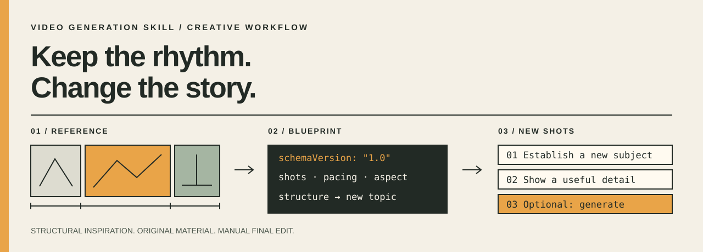
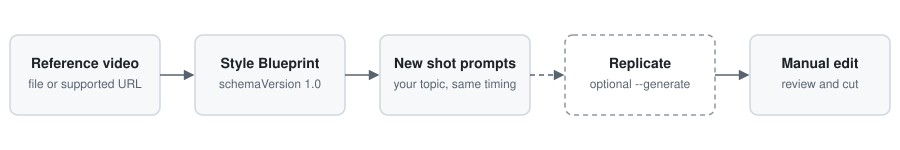

<p align="left"></p>

# clipmimic

**Study a video that works. Make a new one with the same structure.**

clipmimic is a Claude Code skill and plugin. Point it at a TikTok, Instagram Reel, YouTube Short or local video. It breaks the video into shots, hook, pacing, captions and call to action, then writes new shot prompts for your own topic. You can optionally send those prompts to Replicate to generate the clips.

It copies structure and style, not footage.

[](LICENSE)

[](CONTRIBUTING.md)
[](.claude/skills/video-generation/SKILL.md)



[How it works](#how-it-works) · [Install](#install) · [Use it](#use-it) · [Commands](#commands) · [Watch in the browser](#watch-a-reference-in-the-browser) · [Platforms](#tiktok-reels-and-shorts) · [Status](#status) · [FAQ](#faq)

## How it works



1. **Analyze.** `/video:analyze` finds the scene cuts with ffmpeg and records shot lengths, pacing and aspect ratio. For a URL it also saves the title, hashtags, engagement counts and the video's own captions. The result is a **Style Blueprint**, a JSON file you can read and edit.
2. **Enrich (optional).** `/video:watch` has Claude open the video in your browser and describe each shot, the hook, on-screen text and caption style. `/video:enrich` merges that into the blueprint.
3. **Mimic.** `/video:mimic` turns the blueprint and your topic into one prompt per shot, matching the reference's timing.
4. **Generate (optional, paid).** Add `--generate` to send the prompts to Replicate. You assemble the clips yourself.

## Install

You need Claude Code, Node.js 18+, and `ffmpeg` (with `ffprobe`). URL references also need `yt-dlp`. On macOS: `brew install ffmpeg yt-dlp`.

### As a plugin

```text
/plugin marketplace add splashxmoon/clipmimic
/plugin install video@video-generation-marketplace
```

The plugin is named `video`, so the commands appear as `/video:analyze`, `/video:mimic` and so on.

### As project files

From a checkout of this repo:

```sh
mkdir -p /path/to/your-project/.claude/skills
cp -R .claude/skills/video-generation /path/to/your-project/.claude/skills/
cp -R .claude/commands /path/to/your-project/.claude/
```

Install into the project, not `~/.claude`. The commands call the scripts by project-relative path.

## Use it

```text
/video:analyze ref.mp4 --out blueprint.json
/video:mimic blueprint.json --topic "A launch video for a refillable water bottle" --platform tiktok
```

Read the blueprint and the prompts before you spend anything. Add `--keyframes frames` to `analyze` to save a frame image per shot.

No slash commands? Run the scripts directly from your project root:

```sh
node .claude/skills/video-generation/commands/analyze.js ref.mp4 --out blueprint.json
node .claude/skills/video-generation/commands/mimic.js blueprint.json --topic "A launch video for a refillable water bottle"
```

### Generating clips

Generation is optional and **costs money**. Set a Replicate token in the environment (never commit it):

```sh
export REPLICATE_API_TOKEN="your-token-here"
```

Set `REPLICATE_MODEL` to `owner/name` or `owner/name:version-hash`. Check the model's current inputs and price first. Then:

```text
/video:mimic blueprint.json --topic "..." --generate
/video:status <job-id>
```

This submits one job per shot and prints the IDs. Each attempt can be billed, so count the shots first.

## Commands

Each command also has a script in `.claude/skills/video-generation/commands/`.

| Command | What it does | Needs |
| --- | --- | --- |
| `/video:analyze <file-or-url> --out blueprint.json` | Scene cuts, shot lengths, pacing, aspect. URLs also get metadata, engagement and captions. | ffmpeg; yt-dlp for URLs. Optional `--keyframes <dir>`, `--no-metadata`, `--no-transcript` |
| `/video:watch <url>` | Claude watches the video in your browser and records what it sees | Claude in Chrome extension |
| `/video:enrich blueprint.json observations.json` | Merges observations into a blueprint, or builds one from them | Nothing external |
| `/video:mimic blueprint.json --topic "..."` | One prompt per shot for your topic. Optional `--brand`, `--style`, `--platform tiktok\|reels\|shorts`, `--json`, `--generate` | Nothing external, except `--generate` |
| `/video:generate <prompt>` | Text to video | Replicate token |
| `/video:generate-image <image-url> <prompt>` | Image to video. A local path is not uploaded for you. | Replicate token |
| `/video:status <job-id>` | State of a generation job | Replicate token |
| `/video:models` | Lists Replicate models, including non-video ones | Replicate token |

## Watch a reference in the browser

With the [Claude in Chrome](https://claude.com/chrome) extension, `/video:watch <url>` has Claude:

1. open the post in a tab you can see and read the title, hashtags and engagement numbers,
2. measure the `<video>` element,
3. seek to each shot and take a screenshot,
4. write what it saw to `observations.json` and run `/video:enrich`.

That fills the gaps ffmpeg can't: hook text and type, shot descriptions, on-screen text, caption style, music and call to action. For the best result, run `/video:analyze` first for exact cut times, then `/video:watch`. Without the extension, the command says so and falls back to `/video:analyze`.

It uses a browser session you control. It does not get around logins or paywalls.

## TikTok, Reels and Shorts

`--platform tiktok|reels|shorts` makes the plan 9:16, adds caption safe-zone framing, carries over the reference's hook line, caption style and call to action, and warns when the reference is too long, too slow, the wrong aspect, or slow to open. The numbers are approximate, so check each platform's current specs.

## Status

Version 0.1. Tested end to end with ffmpeg and yt-dlp on a generated test video and on a real public YouTube video.

| Works now | Not built yet |
| --- | --- |
| Scene cuts, shot lengths, pacing, aspect | Transcription for videos with no captions |
| URL metadata, engagement and captions | Automatic shot descriptions without Claude |
| Browser observation and enrichment | Assembling clips into a finished edit |
| Platform presets for prompts | Providers other than Replicate |
| Replicate submit, status and model listing | |

Scene detection is a heuristic. Fades and fast motion can produce wrong cuts, so check the blueprint. Generation through Replicate has not been run against a live account in this repo's tests.

More detail: [architecture and Blueprint schema](docs/ARCHITECTURE.md) · [roadmap](docs/ROADMAP.md).

## How it compares

| Project | What it does | Difference |
| --- | --- | --- |
| [0xpratzyy/dissect](https://github.com/0xpratzyy/dissect) | Claude Code skill that turns a video into a blueprint | A focused analysis skill. clipmimic adds platform presets, Replicate generation and the browser flow. Try both. |
| [browser-use/video-use](https://github.com/browser-use/video-use) | Edits footage you already have | clipmimic plans new footage |
| [MoneyPrinterTurbo](https://github.com/harry0703/MoneyPrinterTurbo), [ShortGPT](https://github.com/RayVentura/ShortGPT) | Topic to video from stock clips | clipmimic starts from one reference's pacing and hook |
| [reelmimic](https://github.com/edenfunf/reelmimic) | Analyzes a reference and makes a 2D animation | clipmimic is a Claude Code skill and doesn't render animation |

Details and dates: [docs/COMPETITIVE.md](docs/COMPETITIVE.md).

## FAQ

**Does it copy the reference video?**
No. It reuses structure: shot timing, pacing, hook shape. You write and generate new material. It gives you no rights to the reference's footage, script, music or people.

**Which videos can I use?**
Your own, or ones you have the right to study. A public URL is not a license. Follow the platform's terms. Don't bypass DRM, private accounts or paywalls.

**Is it free?**
The code is [MIT licensed](LICENSE). Analysis and prompt planning run locally and call no paid API. Replicate generation is paid and the rate depends on the model. Claude Code has its own plan costs.

**What's in a Style Blueprint?**
Versioned JSON (`schemaVersion: "1.0"`): source, duration, aspect, hook, shots with start and end times, pacing, captions, audio, call to action, plus metadata and engagement for URLs. Example: [examples/style-blueprint.json](examples/style-blueprint.json).

**Which models work?**
Replicate is the only provider. Pick a model that matches the command's inputs, and check its version and price. `/video:models` lists everything, not just video models.

**Do I get a finished video?**
No. You get shot prompts and, optionally, generated clips. Editing, audio and captions are up to you.

**Will it make my video perform like the reference?**
No. Pacing can inform an experiment. It doesn't carry over audience, distribution or quality.

## Contributing

Bug reports, fixtures and pull requests are welcome. See [CONTRIBUTING.md](CONTRIBUTING.md). Report security problems through [SECURITY.md](SECURITY.md).

[MIT License](LICENSE) · [Architecture](docs/ARCHITECTURE.md) · [Roadmap](docs/ROADMAP.md) · [Discoverability plan](docs/DISCOVERABILITY.md)

[](https://star-history.com/#splashxmoon/clipmimic&Date)
