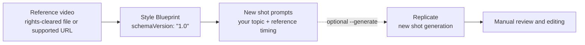

<p align="left"></p>

# clipmimic

**Study the rhythm. Make something new.** An open-source **Claude Code skill** for **AI video generation**: analyze a reference’s shot timing and pacing, turn it into a Style Blueprint, and create prompts for a new topic.

Use it to **mimic reference videos**’ structure and edit rhythm for **short-form** explainers, product demos and **UGC ads**. Replicate can optionally render new shots; final editing remains manual. Structural inspiration does not mean copying footage, scripts, music or a creator’s likeness.

[](LICENSE)

[](CONTRIBUTING.md)
[](.claude/skills/video-generation/SKILL.md)


[Quickstart](#quickstart) · [Commands](#commands) · [What v0.1 does](#what-v01-does) · [FAQ](#faq) · [Contribute](CONTRIBUTING.md)

> **v0.1 scope:** local reference analysis and per-shot prompt planning, with optional paid generation. No transcript extraction, semantic vision descriptions or automatic final-video assembly. Release packaging and slash-command registration must be verified against the tag you install; direct Node commands are provided below.

## From reference to new shots



The blueprint keeps the timing inspectable. It records scene-cut boundaries, shot durations, pacing and aspect ratio; keyframe extraction is optional. Mimic uses that structure to build prompts about your topic. It does not identify the reference’s meaning or recreate a completed edit.

## Quickstart

**Requirements:** Claude Code for the skill workflow; Node.js **18+** for scripts; **ffmpeg + ffprobe** for analysis; **yt-dlp** for supported URL inputs. Local analysis and prompt planning do not call Replicate. Rendering requires a Replicate account and API token and **costs money**. Claude Code access has its own terms/costs.

### Plugin install (tested locally)

```text
/plugin marketplace add splashxmoon/clipmimic
/plugin install video@video-generation-marketplace
```

The plugin is named `video`, so commands appear as `/video:analyze`, `/video:mimic` and so on. Tested with a local checkout in an isolated config; a public GitHub install has not been tested yet.

### 1. Install the skill files

From a checkout of this repository, copy the skill into your project:

```sh
mkdir -p /path/to/your-project/.claude/skills
cp -R .claude/skills/video-generation /path/to/your-project/.claude/skills/
cp -R .claude/commands /path/to/your-project/.claude/
```

`.claude/commands/video/*.md` registers the `/video:*` slash commands (project-level command folders namespace as `video:name`). They call the scripts by project-relative path, so install into the project, not `~/.claude`.

Keep `commands/` and `lib/` together. On macOS, the analysis tools can be installed with `brew install ffmpeg yt-dlp`; on other platforms install those tools through your preferred package manager and confirm they are on `PATH`.

**Future distribution route:** once the public repository layout has been validated with the skills CLI, installation can use `npx skills add splashxmoon/clipmimic`. The owner/repo are placeholders; this route is not yet a verified published install. Copying JavaScript files alone does not establish `/video:*` slash-command registration.

### 2. Analyze a local reference and plan new shots

In Claude Code, the documented command interface is:

```text
/video:analyze ref.mp4 --out blueprint.json
/video:mimic blueprint.json --topic "A launch video for a refillable water bottle"
```

If your installed release does not expose those slash commands, run the scripts from your project root:

```sh
node .claude/skills/video-generation/commands/analyze.js ref.mp4 --out blueprint.json
node .claude/skills/video-generation/commands/mimic.js blueprint.json --topic "A launch video for a refillable water bottle"
```

To save keyframes, add `--keyframes frames` to analysis. URL input additionally needs yt-dlp and permission to access/use that source. Inspect the resulting blueprint and prompts before spending on rendering.

### 3. Optionally generate new shots

Set the token in the environment used by Claude Code or your terminal; never commit it:

```sh
export REPLICATE_API_TOKEN="your-token-here"
```

Use a currently available, compatible Replicate model. `REPLICATE_MODEL` can override the configured model with `owner/name:version-hash`; verify model version, input schema and pricing before submitting. Bundled defaults are not a guarantee of continued model availability.

```text
/video:mimic blueprint.json --topic "A launch video for a refillable water bottle" --generate
/video:status <job-id>
```

Or use the same `mimic.js` Node command above with `--generate`. This submits individual shot jobs and prints their IDs; it does not assemble a final video. Each attempt can incur a charge. Review the number of shots before running, then check the jobs and edit selected outputs in your preferred editor.

## Commands

These are the documented Claude Code command names. Each has a matching script in `.claude/skills/video-generation/commands/` for direct Node execution.

| Command | Purpose | Requirements / output |
| --- | --- | --- |
| `/video:analyze <file-or-url> --out blueprint.json` | Detect scene cuts, shot durations, pacing and aspect | ffmpeg/ffprobe; yt-dlp for URLs. Optional `--keyframes <dir>` |
| `/video:mimic blueprint.json --topic "..."` | Build per-shot prompts for your topic | Local planning; optional `--brand`, `--style`; `--generate` submits paid jobs |
| `/video:generate <prompt>` | Generate video from a text prompt | Replicate token and compatible model |
| `/video:generate-image <image-url-or-path> <prompt>` | Generate video from an image and prompt | Replicate token; image must be accessible in the format the model accepts; a local path is not automatically uploaded |
| `/video:status <job-id>` | Inspect a prediction’s current state | Replicate token |
| `/video:models` | List models through Replicate | Replicate token; results are not restricted to video models |

## What v0.1 does

| Available scope | Still on the roadmap |
| --- | --- |
| Scene-cut detection and shot boundaries | Transcript and hook-text extraction |
| Shot durations, pacing and aspect ratio | Vision-based scene descriptions |
| Optional extracted keyframes | Semantic understanding of a reference |
| Style Blueprint with `schemaVersion: "1.0"` | Automatic assembly into a final edit |
| Optional Replicate job submission, status and generation helpers | Broader provider integrations |

Scene detection is a heuristic: fades, fast motion and similar shots can produce imperfect boundaries. Inspect the blueprint before using it. “UGC ads” describes a possible creative format, not a claim of authentic customer endorsement or proven ad results.

Read the [architecture and Blueprint contract](docs/ARCHITECTURE.md) and [roadmap](docs/ROADMAP.md) for implementation details and planned work. The installed release is the source of truth for supported behavior.

## FAQ

**Does this copy an exact reference video?**  
No. The workflow reuses structure and style cues such as pacing and shot duration to plan new material. It does not grant rights to footage, scripts, music, trademarks or someone’s likeness, and it cannot guarantee an identical result.

**Which references can I use?**  
Use your own footage or references you have permission to access and use for the intended purpose. Follow source-platform terms and applicable rights, including music and likeness permissions. A public URL is not a license. Do not bypass DRM, private accounts or other access restrictions.

**Is it free?**  
The code is [MIT licensed](LICENSE). Local analysis and prompt-only mimic make no Replicate requests. Replicate generation is paid, rates depend on the model, and retries/multiple shots can increase costs. Claude Code may also require a paid account. No free generation credits are included.

**What is inside a Style Blueprint?**  
Versioned JSON (`schemaVersion: "1.0"`) describing a reference’s technical structure: timing, shots, pacing and aspect, with keyframes when requested. It is not a transcript or a vision-generated scene summary. See the [schema documentation](docs/ARCHITECTURE.md).

**Which generation models work?**  
Replicate is the current provider gateway. Choose a model compatible with the command’s inputs and verify its current version and pricing. Model listings can include non-video models; schemas differ and not every model is supported by every command.

**Will I get a finished edited video?**  
Not automatically. Mimic produces shot prompts and optionally submits generation jobs. Review and assemble outputs yourself; audio, captions and final editing remain your responsibility.

**Will this reproduce a high-performing ad’s results?**  
No. A reference’s pacing can inform an experiment; it does not transfer audience fit, distribution, creative quality or measured business results.

## Help shape the next cut

Useful contributions include clearer install instructions, reproducible analysis failures, model compatibility notes and rights-cleared examples. Start with [CONTRIBUTING.md](CONTRIBUTING.md). Include your Node/ffmpeg versions and a minimal example in bug reports; never include API tokens or private media.

If the project is useful, a star helps others find it. Contributions and honest feedback matter more than the count.

<!-- Replace owner/repo placeholders with the canonical public repository before launch. -->
[](https://star-history.com/#%3Cowner%3E/%3Crepo%3E&Date)

Brand assets: [logo](assets/logo.svg), [banner](assets/banner.svg), [1280×640 social preview](assets/social-preview.svg). The preview is an SVG source: export a PNG/JPG under 1 MB and upload it in GitHub Settings → Social preview manually. Artwork illustrates the workflow; it is not generated output or a benchmark.

[MIT License](LICENSE) · [Architecture](docs/ARCHITECTURE.md) · [Roadmap](docs/ROADMAP.md) · [Discoverability plan](docs/DISCOVERABILITY.md)
