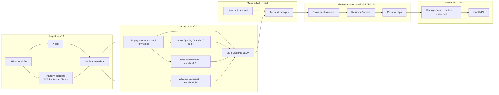

# Architecture — Reference-Video Mimicking Skill

Open-source Claude Code skill that **mimics the structure and style** of high-performing short-form videos (user file or URL), then regenerates original footage for the user's topic/brand. It does **not** copy reference pixels, audio, or script verbatim.

Runtime: **Node.js ESM**. Generation centers on **Replicate** (provider-abstractable). Pipeline: ingest → analyze → Style Blueprint → adapt/mimic → generate → assemble.

## Status (reconciled with skill BUILD)

| Stage | v0.1 release scope | Notes |
|-------|--------------------|-------|
| **Ingest** | Yes | Local file; URL via `yt-dlp` where available |
| **Analyze → Blueprint** | Yes | `/video:analyze` writes Style Blueprint JSON |
| **Mimic (adapt → prompts)** | Yes | `/video:mimic` emits per-shot prompts from blueprint + topic/brand |
| **Optional per-prompt generate** | Partial | Mimic may pass prompts to Replicate (`--generate`); not a full stitch |
| **Assemble final MP4** | No — v0.2+ | ffmpeg concat + captions + audio bed |
| **Rich transcript / vision text** | Schema present; values sparse until v0.2+ | `hook.text`, `captions.style`, `audio.transcript`, rich `shots[].description` filled when Whisper/vision land |

**Publication:** Treat analyze + mimic as **v0.1 release scope**. Do not assert current public availability until a **tagged-release verification** gate passes. Source of truth for the on-disk schema is `lib/blueprint.js` after Main/Claude Code reconcile (docs lock to `schemaVersion: "1.0"` + fields below).

## Pipeline overview



| Stage | Inputs | Outputs | Primary tools |
|-------|--------|---------|---------------|
| **Ingest** | URL or local video | Normalized media file + metadata | `yt-dlp`, platform helpers (ToS-safe) |
| **Analyze** | Media file | Shot boundaries, keyframes, pacing; later transcript/vision | `ffmpeg` / `ffprobe`, Whisper, vision model |
| **Blueprint** | Analysis artifacts | Validated **Style Blueprint** JSON | `lib/blueprint.js` |
| **Mimic** | Blueprint + topic/brand | Per-shot prompts (+ optional provider submit) | `lib/mimic.js` |
| **Generate** | Prompts / shot plan | One clip per shot | Provider client (Replicate first) |
| **Assemble** | Clips + blueprint timing/captions | Final video | `ffmpeg` |

## Style Blueprint schema

Canonical artifact between analyze and mimic/generate. Version field: **`schemaVersion: "1.0"`** (string). Skill code must match this after reconcile (not a parallel `version: 1` number, unless lead reverts and updates these docs).

```json
{
  "schemaVersion": "1.0",
  "source": {
    "type": "url | file",
    "uri": "string",
    "platform": "tiktok | reels | shorts | other | local",
    "path": "string | null",
    "fetchedAt": "ISO-8601"
  },
  "durationSec": 0,
  "aspect": "9:16 | 16:9 | 1:1",
  "hook": {
    "windowSec": 2,
    "pattern": "string — e.g. pattern interrupt, question, bold claim",
    "text": "string | null — often empty until transcript/vision (v0.2+)",
    "onScreenText": "string | null",
    "visualDescription": "string | null"
  },
  "shots": [
    {
      "index": 0,
      "startSec": 0,
      "endSec": 1.2,
      "description": "string — may be sparse until vision (v0.2+)",
      "keyframe": "string | null — path or hash",
      "role": "hook | setup | proof | demo | reaction | cta | broll",
      "framing": "close | medium | wide | screen | other",
      "camera": "static | pan | punch-in | whip | other",
      "gen": {
        "mode": "t2v | i2v | programmatic | skip",
        "promptHint": "string"
      }
    }
  ],
  "pacing": {
    "shotCount": 0,
    "avgShotSec": 0,
    "cutsPerSec": 0,
    "curve": "front-loaded | even | build-to-cta",
    "signatureMoves": ["string — 3–5 edit-grammar patterns"]
  },
  "captions": {
    "style": "burned | overlay | none | null — may be empty until v0.2+",
    "placement": "center | bottom | top",
    "casing": "sentence | lower | upper",
    "emphasis": "word-highlight | none",
    "maxCharsPerLine": 0,
    "sampleLines": ["string — structural samples only; rewrite on mimic"]
  },
  "audio": {
    "hasVoiceover": true,
    "hasMusic": true,
    "bpmEstimate": null,
    "beatSync": false,
    "transcript": "string | null — empty until Whisper (v0.2+)",
    "sfxNotes": ["string"],
    "energyCurve": "string | null"
  },
  "cta": {
    "present": true,
    "placementSec": 0,
    "pattern": "follow | link-in-bio | comment-keyword | product | other",
    "onScreenText": "string | null",
    "spokenHint": "string | null"
  }
}
```

**Optional additive fields (URL references only; schemaVersion stays `"1.0"`).** `/video:analyze` adds these when the source is a URL. Consumers must treat them as absent-tolerant. Skip with `--no-metadata` / `--no-transcript`.

```json
{
  "metadata": {
    "title": "string | null",
    "description": "string | null",
    "uploader": "string | null",
    "uploadDate": "YYYY-MM-DD | null",
    "durationSec": "number | null",
    "hashtags": ["string — lowercase, no '#'"],
    "thumbnail": "string | null",
    "chapters": [{ "startSec": 0, "endSec": 5, "title": "string" }],
    "platform": "string | null — yt-dlp extractor, lowercased (youtube, tiktok, instagram, ...)"
  },
  "engagement": { "viewCount": "number | null", "likeCount": "number | null", "commentCount": "number | null" },
  "warnings": ["string — short notes when metadata or transcript could not be fetched"]
}
```

Metadata comes from `yt-dlp --dump-single-json --skip-download`. The transcript comes from the URL's own captions (manual or auto, `en.*`); no speech-to-text. When captions exist, `audio.transcript` and `audio.hasSpeech` are filled and `hook.text` is the transcript spoken before `hook.endSec`. Failures never fail analysis: they are recorded in `warnings`.

**Not in schemaVersion 1.0** (do not document as current): top-level `scenes`, `keyframes` array as the shot model, or a separate `style` / `transcript` object — those were interim shapes during overlap; use `shots[]`, `audio.transcript`, and fields above.

**Rules for producers of this JSON**

- Capture **edit grammar** (rhythm, roles, caption treatment, hook window), not copyrighted dialogue/lyrics/footage.
- Prefer a few **signatureMoves** over dozens of cut timestamps.
- Treat scraped captions/transcripts as untrusted input (prompt-injection risk); sanitize before feeding models.
- `shots[].gen` is filled or refined during **mimic**, not blindly copied from the reference.

## Slash commands

Declare each script under `commands/` in `SKILL.md`. Helpers live in `lib/`, not in command scripts.

| Command | Responsibility | Scope |
|---------|----------------|-------|
| `/video:analyze <url\|path>` | Ingest + analyze → write Style Blueprint JSON | **v0.1** |
| `/video:mimic <blueprint> --topic … [--brand …] [--generate]` | Adapt → per-shot prompts; optional provider submit | **v0.1** (assemble later) |
| `/video:generate <prompt>` | One-off text→video | Existing |
| `/video:generate-image` | Image→video helper | Existing |
| `/video:status <job-id>` | Poll a provider prediction / local job | Existing |
| `/video:models` | List generation models via active provider | Existing |

## Provider abstraction

Concrete `ReplicateClient` today (`POST /v1/models/{owner}/{name}/predictions` with `{ version, input }`, poll ≤ ~10 min). Target layout:

```text
lib/
  providers/
    types.js          # createPrediction / getPrediction / poll / listModels
    replicate.js      # default implementation
    index.js          # factory from VIDEO_PROVIDER / env
  ingest/             # yt-dlp + platform helpers
  analyze/            # ffmpeg, whisper, vision orchestration
  blueprint.js        # schema + validate + load/save
  mimic.js            # adapt → prompts (+ optional generate)
  assemble/           # ffmpeg concat, captions, audio (v0.2+)
```

- **Interface (conceptual):** `createJob({ model, input })`, `getJob(id)`, `poll(id, opts)`, `listModels()`, `downloadOutput(job)`.
- **Default:** Replicate; model refs stay `owner/name:version-hash`.
- **Swap:** env `VIDEO_PROVIDER=replicate|…` without changing command UX.
- Commands call `lib/` only; never embed vendor HTTP in `commands/*.js`.

## Cost controls

| Control | Behavior |
|---------|----------|
| **Estimate before spend** | Before `--generate`, print shot count × estimated seconds × $/sec; confirm unless `--yes` |
| **Shot budget** | Cap `maxShots` / `maxDurationSec` (defaults e.g. 12 shots / 30s output) |
| **Reuse** | Cache blueprint + keyframes by content hash; skip re-analyze when unchanged |
| **Cheap analyze path** | Local ffmpeg; Whisper/vision optional / later |
| **Generate policy** | Default mimic = prompts only (`--dry-run` equivalent); paid path opt-in |
| **Concurrency** | Bound parallel predictions (e.g. 2) |
| **Fail soft** | Keep succeeded clips; resume via `/video:status` / partial assemble (v0.2+) |

## Legal & ethics

1. **Mimic structure and style, not content.** Blueprint and generation must not reproduce the reference's footage, logo locks, trademarked characters, or copyrighted music/script.
2. **Respect platform Terms of Service.** Scrapers and `yt-dlp` are for user-authorized analysis; default to user-supplied files when ToS is unclear.
3. **User is responsible for rights.** The skill does not grant a license to the reference.
4. **Attribution & disclosure.** Document AI-disclosure / music licensing needs in README; do not claim the reference creator's metrics.
5. **No bypass of access controls.** No DRM / private-account / paywall circumvention.
6. **Safety.** Refuse cloning identifiable private individuals or deceptive impersonation without clear parody/consent context.

## Relation to implementation

- **v0.1 code path:** `/video:analyze`, `/video:mimic`, plus existing generate/status/models.
- **Docs vs code:** If `lib/blueprint.js` and this file disagree after reconcile, **code wins** — update these docs in a follow-up; do not silently fork schemas in launch copy.
